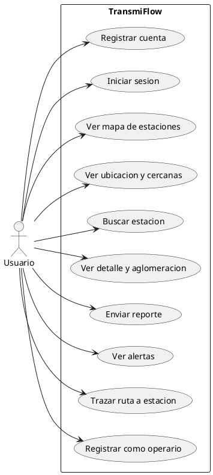

# 📘 TransmiFlow - Documento de Casos de Uso

## 1. Tabla de casos de uso

| ID | Nombre | Actoro | Descripción |
|----|--------|--------|-------------|
| UC-01 | Registrar cuenta | Usuario | El usuario se registra con nombre, email y contrasena. |
| UC-02 | Iniciar sesion | Usuario | El usuario inicia sesion con email y contrasena. |
| UC-03 | Ver mapa de estaciones | Usuario | El usuario ve el mapa con las estaciones de TransMilenio. |
| UC-04 | Ver ubicacion y estaciones cercanas | Usuario | El usuario activa el GPS y ve su ubicacion + estaciones cercanas. |
| UC-05 | Buscar estacion | Usuario | El usuario busca por nombre o troncal. |
| UC-06 | Ver detalle y aglomeracion | Usuario | El usuario ve aglomeracion, capacidad y estaciones cercanas. |
| UC-07 | Enviar reporte | Usuario | El usuario reporta aglomeracion en una estacion. |
| UC-08 | Ver alertas | Usuario | El usuario ve alertas de alta aglomeracion. |
| UC-09 | Trazar ruta a estacion | Usuario | El usuario pide la ruta desde su GPS hasta la estacion final. |
| UC-10 | Registrar como operario | Usuario | El usuario se registra con rol de operario. |

## 2. Diagrama de casos de uso (PlantUML)

## 3. Reglas de negocio

- El nivel de aglomeracion se calcula con terciles sobre la capacidad (cap_art + cap_biart).
- Solo se consideran reportes de las ultimas 24 horas para alertas.

## 4. Escenario principal del UC-09 (Trazar ruta)

1. El usuario presiona el boton "Mi estacion mas cercana".
2. El sistema obtiene su ubicacion (GPS).
3. El sistema calcula la estacion mas cercana.
4. El sistema consulta la ruta (OSRM).
5. El sistema dibuja la linea azul hasta la estacion.

## 5. Escenario principal del UC-10 (Registrar como operario)

1. El usuario se registra con rol de operario.
2. El sistema guarda el rol en la base de datos.
3. El sistema devuelve el rol al frontend.
