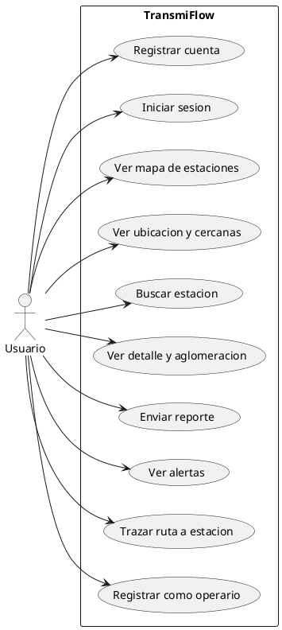
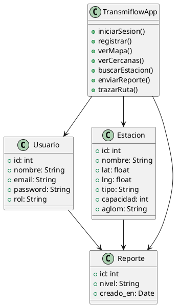
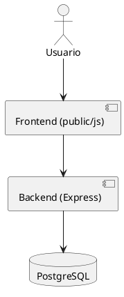
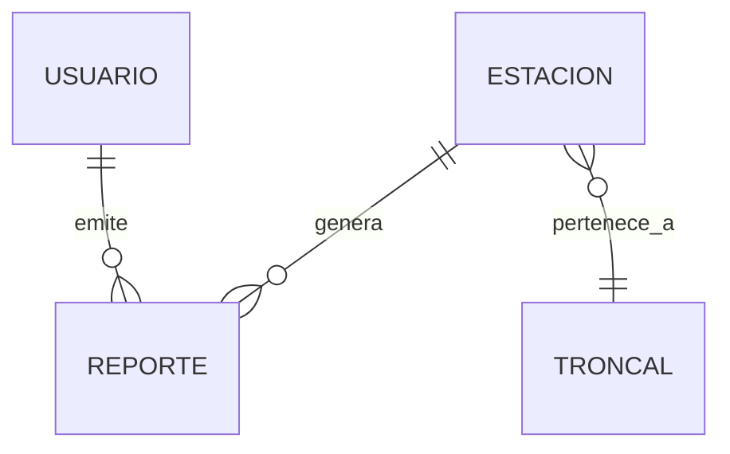
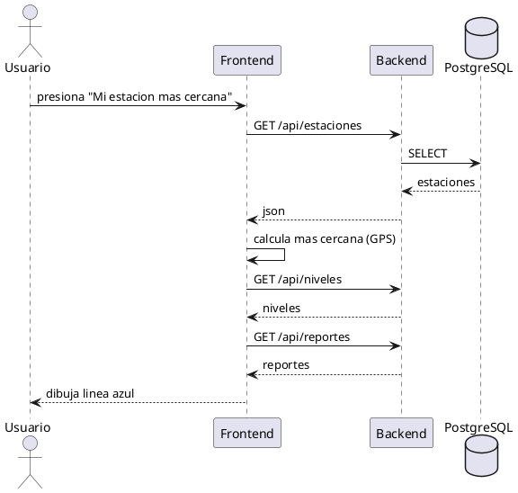

# 🧩 TransmiFlow - Diagramas UML

## 1. Diagrama de casos de uso (PlantUML)

## 2. Diagrama de clases (PlantUML)

## 3. Diagrama de componentes (PlantUML)

## 4. Diagrama ER (Mermaid)

## 5. Diagrama de secuencia (flujo: ruta)

