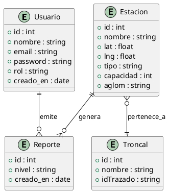

# 🗄️ TransmiFlow - Modelo Entidad-Relacion

## Entidades

### Usuario
| Atributo | Tipo |
|---|---|
| id | int |
| nombre | string |
| email | string |
| password | string |
| rol | string (usuario / operario) |
| creado_en | date |

### Estacion
| Atributo | Tipo |
|---|---|
| id | int |
| nombre | string |
| lat | float |
| lng | float |
| tipo | string (Troncal / Portal) |
| capacidad | int |
| aglomeracion | string (Baja / Media / Alta) |
| troncal | string |

### Reporte
| Atributo | Tipo |
|---|---|
| id | int |
| estacion | string |
| nivel | string |
| usuario | string |
| creado_en | date |

## Relaciones

- **Usuario 1..N → Reporte N..1** : un usuario emite muchos reportes.
- **Estacion 1..N → Reporte N..1** : una estacion recibe muchos reportes.
- **Estacion N..1 → Troncal 1** : una estacion pertenece a un troncal.

## Diagrama ER (PlantUML)

